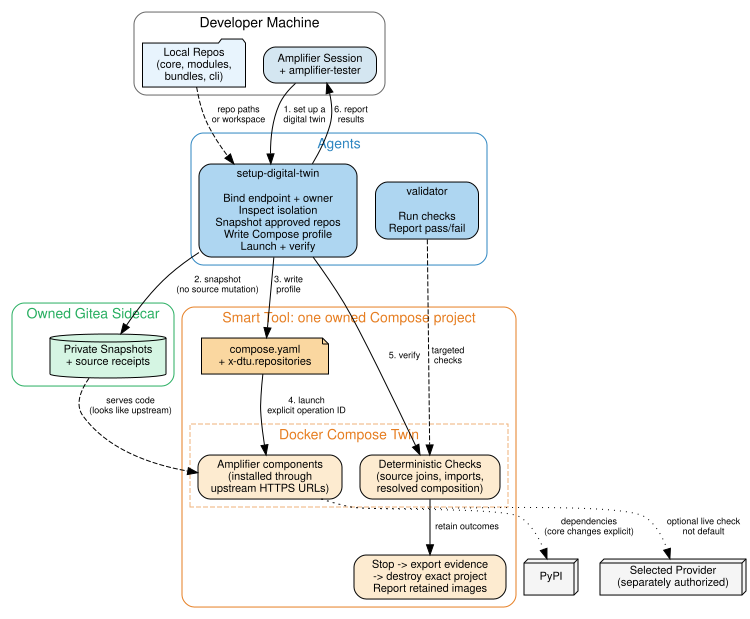

# Amplifier Bundle Amplifier Tester

Validates Amplifier ecosystem changes (bundles, modules, prompts, app-cli, core, foundation) in [Digital Twin Universe](https://github.com/microsoft/amplifier-smart-tool-digital-twin-universe) Docker Compose environments before they reach real users.

The bundle dynamically generates the right profile based on what you actually changed using an agent.
Setup snapshots approved local repos through the Smart Tool's own Gitea sidecar,
writes a Compose profile with `x-dtu.repositories`, and launches it. The validator
checks the installed source and behavior. Default checks need no provider or model call.

Example Uses:

- "I made changes to amplifier-foundation and a couple of modules. Can you spin up a DTU and validate they work together?"
- "I want to try out a lean Amplifier configuration with my custom bundle composed in, without messing with my global Amplifier."




## Prerequisites

The behavior registers the Smart Tool's on-demand skill, not the old DTU/Gitea
bundles. It does **not** install Python packages or Docker. The reviewed interface
is `digital-twin-universe` 0.6.9, source
`88d9d84149eee914372c1ca8d68e9eb9f4ba3290`. It needs Python 3.13+, Docker CLI,
Compose, a reachable explicitly selected daemon, and Git for source snapshots.

For an explicitly authorized installation, deterministic capabilities need no extras:

```bash
uv tool install git+https://github.com/microsoft/amplifier-smart-tool-digital-twin-universe@88d9d84149eee914372c1ca8d68e9eb9f4ba3290
digital-twin-universe --version
digital-twin-universe manifest
digital-twin-universe --help
```

Setup uses the installed library's `check` with a private state root and selected
endpoint. A missing CLI or daemon is an actionable prerequisite, never permission
to install globally, start a service or call model-backed `install`/`create-profile`.
Read the selected tool's [library](https://github.com/microsoft/amplifier-smart-tool-digital-twin-universe/blob/88d9d84149eee914372c1ca8d68e9eb9f4ba3290/docs/01-library.md)
and [profile](https://github.com/microsoft/amplifier-smart-tool-digital-twin-universe/blob/88d9d84149eee914372c1ca8d68e9eb9f4ba3290/docs/03-profile.md)
references. Profiles are trusted Compose programs, not hostile-code sandboxes;
the proxy allowlist is not an egress firewall. Native Windows/WSL live qualification
is not established by this bundle.


## Installation

Hosts that already compose the tester behavior keep the stable
`amplifier-tester:setup-digital-twin` and `amplifier-tester:validator` names.

To compose into a custom bundle (without foundation), reference the behavior:

```bash
amplifier bundle add "git+https://github.com/microsoft/amplifier-bundle-amplifier-tester@main#subdirectory=behaviors/amplifier-tester.yaml" --app
```

`--app` composes the bundle onto every Amplifier session. Remove it to only register the bundle for later activation with `amplifier bundle use`.

This bundle does not select a provider, orchestrator, context manager or host
instruction. It adds the skills tool and tester agents to the host you chose.
The thin root `bundle.md` remains the namespace anchor for repo-level assets.

### Migrating an existing host

Select this updated tester behavior, then explicitly disable the old DTU behavior
from the **new ordinary-testing composition** if it was separately enabled.
Merely updating tester cannot remove another host include. Both tools name their
skill `digital-twin-universe`; source order is first-match-wins. Check
`load_skill(info="digital-twin-universe")` and the composed prompt. Setup reports
a collision and uses the selected executable's help rather than loading the old
manual or silently reordering the host.

Keep legacy records and their original operators/interfaces. An explicit Incus
request returns `unsupported-binding: legacy Incus instance requires its original
owner, endpoint, and amplifier-digital-twin interface`. This bundle never converts,
relaunches or destroys an old instance through Docker. Host activation is a
separate operator action; installing this source alone changes no live configuration.


## What It Validates

- **Core** (`amplifier-core`) -- explicit local wheel/direct source in the app environment, native import and source identity (no `pypi_overrides`)
- **Module** (`amplifier-module-*`) -- URL rewrite to Gitea, smoke test exercises the module
- **Bundle** (`amplifier-bundle-*`) -- snapshot + behavior composition; inspect resolved agents, skills, contexts and preserved host instruction
- **CLI** (`amplifier`, `amplifier-app-cli`) -- URL rewrite for install source, help + smoke test
- **Foundation** (`amplifier-foundation`) -- URL rewrite, bundle loading works
- **Prompt/context** (agent `.md` or context files in a bundle) -- same as bundle, since prompt changes live in bundles
- **Multi-repo** (any combination of the above) -- all strategies combined in a single profile


## Agents

- **[Setup Digital Twin](agents/setup-digital-twin.md)** -- binds the interface, snapshots approved sources, writes a Compose profile, launches and verifies the owned environment.
- **[Ecosystem Validator](agents/validator.md)** -- runs targeted validation checks inside the DTU and reports pass/fail results.


## Typical Flow

```
"Validate my changes to ~/repos/amplifier-module-provider-anthropic"
```

1. **setup-digital-twin** inspects the repo, classifies it as a module change
2. Reviews isolation, checks the selected endpoint, records owner/state/operation and budget
3. Writes `.agents/digital-twin-universe/<name>/compose.yaml` with `x-dtu.repositories`
4. Launches the DTU -- Amplifier installs inside thinking it's pulling from upstream
5. Verifies mounts/home first, installed source identity, then the required deterministic checks
6. Stops, exports evidence and removes the exact owned project, or names its accepting cleanup owner

For multi-repo changes:
```
"Validate my changes to ~/repos/amplifier-core and ~/repos/amplifier-module-provider-anthropic"
```

Both repos get snapshot entries. Install core's exact built wheel/direct source
in the app environment; serving a Git repo does not redirect PyPI resolution.
Verify both source joins in the same guest. Live provider smoke is separate scope.


## Re-testing After Fixes

There is **no in-place update**. Export evidence and stop/remove the known owned
project, then snapshot the changed working tree under a new explicit operation.
Never replay an uncertain launch or execution; a timeout may leave a command
running. Preserve its original ID, state and evidence until reconciled.

### Maintained checks

`python -m pytest tests/ -q` runs local contract guards, not a live lifecycle.
The legacy profile is retained under `tests/fixtures/legacy-incus/` as a negative
counterexample. Historical evaluation 01 is preserved but its runner refuses
before provisioning; it is not silently relabeled as Smart Tool qualification.

The opt-in `tests/run_smart_dtu_lifecycle.py --help` runs the maintained
[Compose fixture](.agents/digital-twin-universe/amplifier-tester-self-validation/compose.yaml).
It requires explicit approved tester/Foundation/skills/Smart Tool source paths,
Docker endpoint, private state/evidence roots, image digest, owner and operation ID.
Run it on the daemon's host (for example, in the approved Spark-2 task folder),
not by pointing Spark-1's local snapshot paths at remote Docker.
It installs Foundation from the served local repository, checks native imports,
loads this behavior, resolves the Smart Tool skill, tests the legacy collision,
and exports evidence before exact-project teardown. No paid calls are made.
Generated Gitea/gateway containers count as sidecars of the owned project.
Built images are reported separately because `destroy` does not remove them.


## Scope

**In scope:** Amplifier ecosystem repos -- core, foundation, modules, bundles, app-cli.

**Out of scope:** Arbitrary user apps (use [reality-check](https://github.com/microsoft/amplifier-bundle-reality-check) for that),
mock services, browser-based UI testing, resolver integration.


## Contributing

> [!NOTE]
> This project is not currently accepting external contributions, but we're actively working toward opening this up. We value community input and look forward to collaborating in the future. For now, feel free to fork and experiment!

Most contributions require you to agree to a
Contributor License Agreement (CLA) declaring that you have the right to, and actually do, grant us
the rights to use your contribution. For details, visit [Contributor License Agreements](https://cla.opensource.microsoft.com).

When you submit a pull request, a CLA bot will automatically determine whether you need to provide
a CLA and decorate the PR appropriately (e.g., status check, comment). Simply follow the instructions
provided by the bot. You will only need to do this once across all repos using our CLA.

This project has adopted the [Microsoft Open Source Code of Conduct](https://opensource.microsoft.com/codeofconduct/).
For more information see the [Code of Conduct FAQ](https://opensource.microsoft.com/codeofconduct/faq/) or
contact [opencode@microsoft.com](mailto:opencode@microsoft.com) with any additional questions or comments.

## Trademarks

This project may contain trademarks or logos for projects, products, or services. Authorized use of Microsoft
trademarks or logos is subject to and must follow
[Microsoft's Trademark & Brand Guidelines](https://www.microsoft.com/legal/intellectualproperty/trademarks/usage/general).
Use of Microsoft trademarks or logos in modified versions of this project must not cause confusion or imply Microsoft sponsorship.
Any use of third-party trademarks or logos are subject to those third-party's policies.
